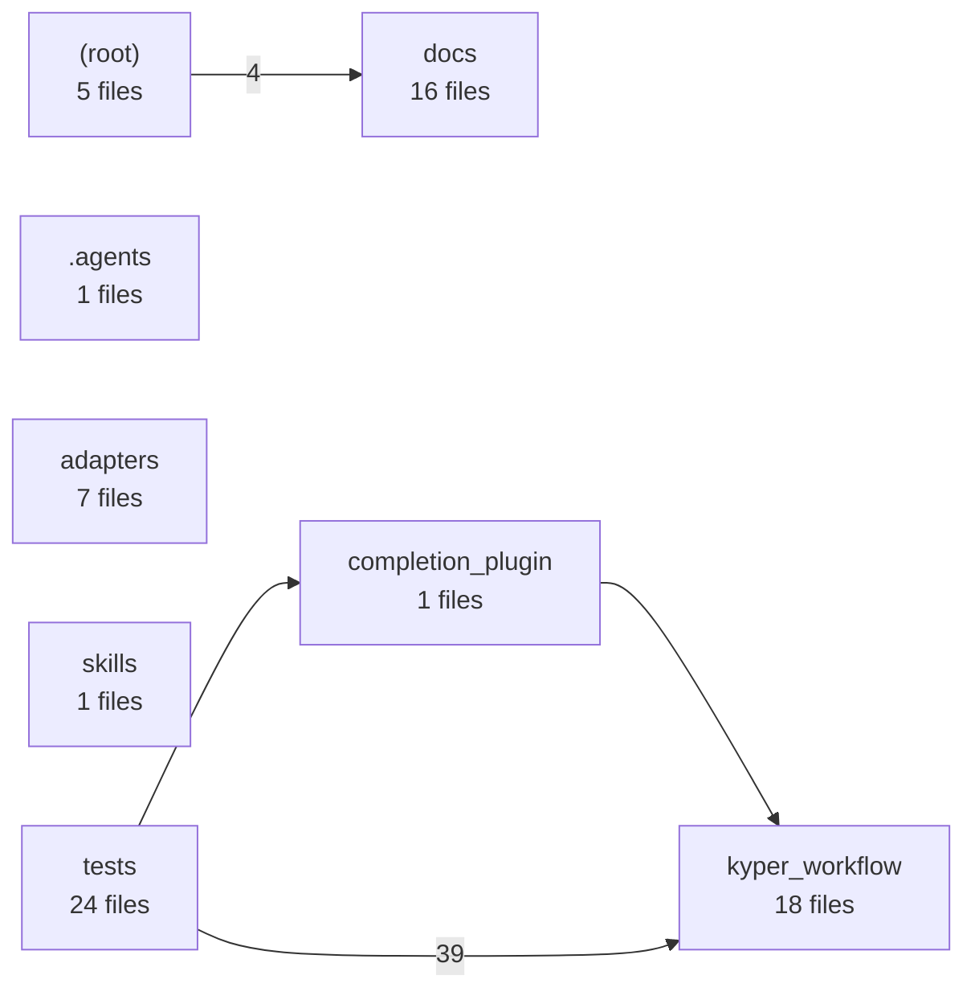

# Project map — KyperWorkflow

Static analysis of local files: paths, line counts, Python imports and relative
document links. No model calls, no semantic claims. Regenerate with
`kyper-workflow map --root . --write`; `--check` fails when this file is stale.

## Overview

- Files: 73
- Lines: 7265
- Languages: javascript 5, json 2, markdown 18, other 4, python 43, toml 1
- Internal dependency edges: 69
- Entry points: `kyper_workflow/cli.py`

## Areas

| Area | Files | Lines | Outbound edges | Inbound edges |
|---|---|---|---|---|
| `(root)` | 5 | 124 | 4 | 0 |
| `.agents` | 1 | 32 | 0 | 0 |
| `adapters` | 7 | 758 | 0 | 0 |
| `completion_plugin` | 1 | 19 | 1 | 1 |
| `docs` | 16 | 918 | 0 | 4 |
| `kyper_workflow` | 18 | 3222 | 0 | 40 |
| `skills` | 1 | 32 | 0 | 0 |
| `tests` | 24 | 2160 | 40 | 0 |

## Relationship graph

One node per file, one directed edge per observed link. Solid arrows are Python
imports, dashed arrows are relative document links. Colour groups files by area and
a thick border marks a detected entry point. Node ids are the file paths used
throughout this map, so the graph, the tables below and `.kyper/project-map.json`
describe the same graph. Machine-readable copies:
`.kyper/project-graph.dot`, `.kyper/project-graph.graphml`, `.kyper/project-graph.tsv`.

- Nodes shown: 40 of 73 files; edges shown: 65 of 69

```mermaid
graph LR
  subgraph g__root_["(root)"]
    g_README_md["README.md<br/>76 lines"]
  end
  subgraph g_completion_plugin["completion_plugin"]
    g_completion_plugin___init___py["completion_plugin/__init__.py<br/>19 lines"]
  end
  subgraph g_docs["docs"]
    g_docs_FIRST_RUN_SETUP_md["docs/FIRST-RUN-SETUP.md<br/>65 lines"]
    g_docs_INSTALL_CODEX_WINDOWS_md["docs/INSTALL-CODEX-WINDOWS.md<br/>67 lines"]
    g_docs_MIGRATION_v0_4_to_plugin_md["docs/MIGRATION-v0.4-to-plugin.md<br/>12 lines"]
    g_docs_RENAME_KYPERWORKFLOW_md["docs/RENAME-KYPERWORKFLOW.md<br/>53 lines"]
  end
  subgraph g_kyper_workflow["kyper_workflow"]
    g_kyper_workflow_usage_py["kyper_workflow/usage.py<br/>126 lines"]
    g_kyper_workflow_workflow_py["kyper_workflow/workflow.py<br/>189 lines"]
    g_kyper_workflow_evidence_py["kyper_workflow/evidence.py<br/>161 lines"]
    g_kyper_workflow_runtime_py["kyper_workflow/runtime.py<br/>104 lines"]
    g_kyper_workflow_cli_py["kyper_workflow/cli.py (entry)<br/>90 lines"]
    g_kyper_workflow_interactive_py["kyper_workflow/interactive.py<br/>92 lines"]
    g_kyper_workflow___init___py["kyper_workflow/__init__.py<br/>2 lines"]
    g_kyper_workflow_editorial_py["kyper_workflow/editorial.py<br/>194 lines"]
    g_kyper_workflow_onboarding_py["kyper_workflow/onboarding.py<br/>192 lines"]
    g_kyper_workflow_profiles_py["kyper_workflow/profiles.py<br/>474 lines"]
    g_kyper_workflow_server_py["kyper_workflow/server.py<br/>60 lines"]
    g_kyper_workflow_structure_py["kyper_workflow/structure.py<br/>740 lines"]
    g_kyper_workflow_locking_py["kyper_workflow/locking.py<br/>44 lines"]
    g_kyper_workflow_windows_process_py["kyper_workflow/windows_process.py<br/>240 lines"]
    g_kyper_workflow_polishing_py["kyper_workflow/polishing.py<br/>198 lines"]
    g_kyper_workflow_process_py["kyper_workflow/process.py<br/>33 lines"]
    g_kyper_workflow_dsh_py["kyper_workflow/dsh.py<br/>251 lines"]
  end
  subgraph g_tests["tests"]
    g_tests_test_dispatch_py["tests/test_dispatch.py<br/>22 lines"]
    g_tests_test_host_attestation_py["tests/test_host_attestation.py<br/>160 lines"]
    g_tests_test_interactive_py["tests/test_interactive.py<br/>57 lines"]
    g_tests_test_acceptance_mode_py["tests/test_acceptance_mode.py<br/>24 lines"]
    g_tests_test_independent_workflow_py["tests/test_independent_workflow.py<br/>360 lines"]
    g_tests_test_runtime_py["tests/test_runtime.py<br/>17 lines"]
    g_tests_test_workflow_py["tests/test_workflow.py<br/>37 lines"]
    g_tests_test_rename_shim_py["tests/test_rename_shim.py<br/>47 lines"]
    g_tests_test_unicode_storage_py["tests/test_unicode_storage.py<br/>9 lines"]
    g_tests_test_dsh_py["tests/test_dsh.py<br/>172 lines"]
    g_tests_test_editorial_py["tests/test_editorial.py<br/>162 lines"]
    g_tests_test_locking_py["tests/test_locking.py<br/>16 lines"]
    g_tests_test_onboarding_py["tests/test_onboarding.py<br/>115 lines"]
    g_tests_test_polishing_py["tests/test_polishing.py<br/>157 lines"]
    g_tests_test_profiles_py["tests/test_profiles.py<br/>268 lines"]
    g_tests_test_project_execution_py["tests/test_project_execution.py<br/>12 lines"]
    g_tests_test_repo_hygiene_py["tests/test_repo_hygiene.py<br/>69 lines"]
  end
  g_README_md -.-> g_docs_FIRST_RUN_SETUP_md
  g_README_md -.-> g_docs_INSTALL_CODEX_WINDOWS_md
  g_README_md -.-> g_docs_MIGRATION_v0_4_to_plugin_md
  g_README_md -.-> g_docs_RENAME_KYPERWORKFLOW_md
  g_completion_plugin___init___py --> g_kyper_workflow___init___py
  g_docs_INSTALL_CODEX_WINDOWS_md -.-> g_docs_FIRST_RUN_SETUP_md
  g_kyper_workflow_cli_py --> g_kyper_workflow_editorial_py
  g_kyper_workflow_cli_py --> g_kyper_workflow_evidence_py
  g_kyper_workflow_cli_py --> g_kyper_workflow_interactive_py
  g_kyper_workflow_cli_py --> g_kyper_workflow_onboarding_py
  g_kyper_workflow_cli_py --> g_kyper_workflow_profiles_py
  g_kyper_workflow_cli_py --> g_kyper_workflow_structure_py
  g_kyper_workflow_cli_py --> g_kyper_workflow_workflow_py
  g_kyper_workflow_evidence_py --> g_kyper_workflow_process_py
  g_kyper_workflow_evidence_py --> g_kyper_workflow_windows_process_py
  g_kyper_workflow_interactive_py --> g_kyper_workflow_runtime_py
  g_kyper_workflow_interactive_py --> g_kyper_workflow_usage_py
  g_kyper_workflow_interactive_py --> g_kyper_workflow_workflow_py
  g_kyper_workflow_onboarding_py --> g_kyper_workflow___init___py
  g_kyper_workflow_polishing_py --> g_kyper_workflow_editorial_py
  g_kyper_workflow_process_py --> g_kyper_workflow_windows_process_py
  g_kyper_workflow_runtime_py --> g_kyper_workflow_evidence_py
  g_kyper_workflow_runtime_py --> g_kyper_workflow_profiles_py
  g_kyper_workflow_server_py --> g_kyper_workflow___init___py
  g_kyper_workflow_server_py --> g_kyper_workflow_editorial_py
  g_kyper_workflow_server_py --> g_kyper_workflow_onboarding_py
  g_kyper_workflow_server_py --> g_kyper_workflow_structure_py
  g_kyper_workflow_usage_py --> g_kyper_workflow_locking_py
  g_kyper_workflow_workflow_py --> g_kyper_workflow_locking_py
  g_tests_test_acceptance_mode_py --> g_kyper_workflow_runtime_py
  g_tests_test_acceptance_mode_py --> g_kyper_workflow_usage_py
  g_tests_test_acceptance_mode_py --> g_kyper_workflow_workflow_py
  g_tests_test_dispatch_py --> g_kyper_workflow_profiles_py
  g_tests_test_dispatch_py --> g_kyper_workflow_runtime_py
  g_tests_test_dispatch_py --> g_kyper_workflow_usage_py
  g_tests_test_dispatch_py --> g_kyper_workflow_workflow_py
  g_tests_test_dsh_py --> g_kyper_workflow_dsh_py
  g_tests_test_editorial_py --> g_kyper_workflow_editorial_py
  g_tests_test_host_attestation_py --> g_kyper_workflow_evidence_py
  g_tests_test_host_attestation_py --> g_kyper_workflow_runtime_py
  g_tests_test_host_attestation_py --> g_kyper_workflow_usage_py
  g_tests_test_host_attestation_py --> g_kyper_workflow_workflow_py
  g_tests_test_independent_workflow_py --> g_kyper_workflow_evidence_py
  g_tests_test_independent_workflow_py --> g_kyper_workflow_usage_py
  g_tests_test_independent_workflow_py --> g_kyper_workflow_workflow_py
  g_tests_test_interactive_py --> g_kyper_workflow_interactive_py
  g_tests_test_interactive_py --> g_kyper_workflow_runtime_py
  g_tests_test_interactive_py --> g_kyper_workflow_usage_py
  g_tests_test_interactive_py --> g_kyper_workflow_workflow_py
  g_tests_test_locking_py --> g_kyper_workflow_locking_py
  g_tests_test_onboarding_py --> g_kyper_workflow_onboarding_py
  g_tests_test_polishing_py --> g_kyper_workflow_polishing_py
  g_tests_test_profiles_py --> g_kyper_workflow_profiles_py
  g_tests_test_project_execution_py --> g_kyper_workflow_evidence_py
  g_tests_test_rename_shim_py --> g_completion_plugin___init___py
  g_tests_test_rename_shim_py --> g_kyper_workflow___init___py
  g_tests_test_repo_hygiene_py --> g_kyper_workflow_structure_py
  g_tests_test_runtime_py --> g_kyper_workflow_runtime_py
  g_tests_test_runtime_py --> g_kyper_workflow_usage_py
  g_tests_test_runtime_py --> g_kyper_workflow_workflow_py
  g_tests_test_unicode_storage_py --> g_kyper_workflow_usage_py
  g_tests_test_unicode_storage_py --> g_kyper_workflow_workflow_py
  g_tests_test_workflow_py --> g_kyper_workflow_evidence_py
  g_tests_test_workflow_py --> g_kyper_workflow_usage_py
  g_tests_test_workflow_py --> g_kyper_workflow_workflow_py
  classDef g_area__root_ fill:#e8eef6,stroke:#4e79a7,color:#1a1a1a;
  classDef g_area__agents fill:#fdefe0,stroke:#f28e2b,color:#1a1a1a;
  classDef g_area_adapters fill:#fbe7e7,stroke:#e15759,color:#1a1a1a;
  classDef g_area_completion_plugin fill:#e6f1f0,stroke:#76b7b2,color:#1a1a1a;
  classDef g_area_docs fill:#e7f2e5,stroke:#59a14f,color:#1a1a1a;
  classDef g_area_kyper_workflow fill:#faf3d9,stroke:#edc948,color:#1a1a1a;
  classDef g_area_skills fill:#f0e9f1,stroke:#b07aa1,color:#1a1a1a;
  classDef g_area_tests fill:#fdeef0,stroke:#ff9da7,color:#1a1a1a;
  classDef entry stroke:#111111,stroke-width:2px;
  class g_kyper_workflow_usage_py g_area_kyper_workflow;
  class g_kyper_workflow_workflow_py g_area_kyper_workflow;
  class g_kyper_workflow_evidence_py g_area_kyper_workflow;
  class g_kyper_workflow_runtime_py g_area_kyper_workflow;
  class g_kyper_workflow_cli_py g_area_kyper_workflow,entry;
  class g_kyper_workflow_interactive_py g_area_kyper_workflow;
  class g_README_md g_area__root_;
  class g_kyper_workflow___init___py g_area_kyper_workflow;
  class g_kyper_workflow_editorial_py g_area_kyper_workflow;
  class g_kyper_workflow_onboarding_py g_area_kyper_workflow;
  class g_kyper_workflow_profiles_py g_area_kyper_workflow;
  class g_kyper_workflow_server_py g_area_kyper_workflow;
  class g_kyper_workflow_structure_py g_area_kyper_workflow;
  class g_tests_test_dispatch_py g_area_tests;
  class g_tests_test_host_attestation_py g_area_tests;
  class g_tests_test_interactive_py g_area_tests;
  class g_kyper_workflow_locking_py g_area_kyper_workflow;
  class g_kyper_workflow_windows_process_py g_area_kyper_workflow;
  class g_tests_test_acceptance_mode_py g_area_tests;
  class g_tests_test_independent_workflow_py g_area_tests;
  class g_tests_test_runtime_py g_area_tests;
  class g_tests_test_workflow_py g_area_tests;
  class g_completion_plugin___init___py g_area_completion_plugin;
  class g_docs_FIRST_RUN_SETUP_md g_area_docs;
  class g_docs_INSTALL_CODEX_WINDOWS_md g_area_docs;
  class g_kyper_workflow_polishing_py g_area_kyper_workflow;
  class g_kyper_workflow_process_py g_area_kyper_workflow;
  class g_tests_test_rename_shim_py g_area_tests;
  class g_tests_test_unicode_storage_py g_area_tests;
  class g_docs_MIGRATION_v0_4_to_plugin_md g_area_docs;
  class g_docs_RENAME_KYPERWORKFLOW_md g_area_docs;
  class g_kyper_workflow_dsh_py g_area_kyper_workflow;
  class g_tests_test_dsh_py g_area_tests;
  class g_tests_test_editorial_py g_area_tests;
  class g_tests_test_locking_py g_area_tests;
  class g_tests_test_onboarding_py g_area_tests;
  class g_tests_test_polishing_py g_area_tests;
  class g_tests_test_profiles_py g_area_tests;
  class g_tests_test_project_execution_py g_area_tests;
  class g_tests_test_repo_hygiene_py g_area_tests;
```

_4 lower-degree file node(s) omitted; the complete graph is in the graph exports and the JSON map._

### Area summary

The same graph collapsed to one node per area, with edge counts.

## Files

### `(root)`

| File | Lines | Symbols | Summary | Internal imports |
|---|---|---|---|---|
| `.gitignore` | 14 |  | — | — |
| `LICENSE` | 10 |  | — | — |
| `README.md` | 76 |  | KyperWorkflow 0.2.0 | — |
| `THIRD_PARTY_NOTICES.md` | 10 |  | Sources and licensing | — |
| `pyproject.toml` | 14 |  | — | — |

### `.agents`

| File | Lines | Symbols | Summary | Internal imports |
|---|---|---|---|---|
| `.agents/skills/kyper-workflow/SKILL.md` | 32 |  | — | — |

### `adapters`

| File | Lines | Symbols | Summary | Internal imports |
|---|---|---|---|---|
| `adapters/dsh/README.md` | 221 |  | KyperWorkflow DSH adapter | — |
| `adapters/dsh/bridge.js` | 165 |  | — | — |
| `adapters/dsh/bridge.test.js` | 117 |  | — | — |
| `adapters/dsh/index.js` | 15 |  | — | — |
| `adapters/dsh/integration-example.mjs` | 103 |  | — | — |
| `adapters/dsh/package.json` | 28 |  | — | — |
| `adapters/dsh/profiles.js` | 109 |  | — | — |

### `completion_plugin`

| File | Lines | Symbols | Summary | Internal imports |
|---|---|---|---|---|
| `completion_plugin/__init__.py` | 19 | 0 fn / 0 cls | Deprecated import path. | `kyper_workflow/__init__.py` |

### `docs`

| File | Lines | Symbols | Summary | Internal imports |
|---|---|---|---|---|
| `docs/FIRST-RUN-SETUP.md` | 65 |  | 首次接入配置（KyperWorkflow） | — |
| `docs/IMPLEMENTATION-STATUS.md` | 30 |  | Implementation status — 2026-11-17 | — |
| `docs/INSTALL-CODEX-WINDOWS.md` | 67 |  | Codex 与 Windows 手动试用（v0.1.2） | — |
| `docs/MIGRATION-v0.4-to-plugin.md` | 12 |  | 从旧 MCP v0.4 迁移 | — |
| `docs/PLUGIN-REFACTOR-SPEC.md` | 234 |  | KyperWorkflow 通用插件重构规格 | — |
| `docs/RELEASE-0.1.1.md` | 7 |  | 0.1.1 Windows storage compatibility patch | — |
| `docs/RELEASE-0.1.2.md` | 19 |  | 0.1.2 Windows runner and Unicode patch | — |
| `docs/RENAME-KYPERWORKFLOW.md` | 53 |  | 改名：CompletionQAMCP → KyperWorkflow | — |
| `docs/STAGE-20261019-0300.md` | 9 |  | QA 插件阶段记录 | — |
| `docs/TASK-MATRIX.md` | 47 |  | spec-v002 implementation matrix | — |
| `docs/TEXT-POLISHING.md` | 12 |  | Using the writing workflow | — |
| `docs/VALIDATION.md` | 100 |  | Current validation | — |
| `docs/WINDOWS-RUNNER.md` | 60 |  | Windows contained process runner | — |
| `docs/dsh-tests.log` | 26 |  | — | — |
| `docs/python-tests.log` | 156 |  | — | — |
| `docs/setup.local.example.json` | 21 |  | — | — |

### `kyper_workflow`

| File | Lines | Symbols | Summary | Internal imports |
|---|---|---|---|---|
| `kyper_workflow/__init__.py` | 2 | 0 fn / 0 cls | KyperWorkflow: explicit specification approval, bounded review and project mapping. | — |
| `kyper_workflow/cli.py` | 90 | 1 fn / 0 cls | Local explicit actions. No automatic user confirmation through model inputs. | `kyper_workflow/editorial.py`, `kyper_workflow/evidence.py`, `kyper_workflow/interactive.py`, `kyper_workflow/onboarding.py`, `kyper_workflow/profiles.py`, `kyper_workflow/structure.py` |
| `kyper_workflow/dsh.py` | 251 | 15 fn / 2 cls | Stdlib-only DSH bridge contract; not an installed DSH plugin. | — |
| `kyper_workflow/editorial.py` | 194 | 6 fn / 0 cls | Deterministic, review-only Chinese/English editorial assistance. | — |
| `kyper_workflow/evidence.py` | 161 | 11 fn / 1 cls | Bounded direct-content checks; trusted local runner, not tamper protection. | `kyper_workflow/process.py`, `kyper_workflow/windows_process.py` |
| `kyper_workflow/interactive.py` | 92 | 4 fn / 0 cls | Operator-facing terminal workflow. Agent/host users should use trusted adapters. | `kyper_workflow/runtime.py`, `kyper_workflow/usage.py`, `kyper_workflow/workflow.py` |
| `kyper_workflow/locking.py` | 44 | 1 fn / 0 cls | Local advisory writer lock for POSIX and Windows, with bounded waiting. | — |
| `kyper_workflow/onboarding.py` | 192 | 5 fn / 0 cls | First-run configuration checklist. | `kyper_workflow/__init__.py` |
| `kyper_workflow/polishing.py` | 198 | 6 fn / 3 cls | Host-injected candidate generation and review; no network/provider client. | `kyper_workflow/editorial.py` |
| `kyper_workflow/process.py` | 33 | 2 fn / 0 cls | Bounded time/output reads for explicitly trusted POSIX or Windows project commands. | `kyper_workflow/windows_process.py` |
| `kyper_workflow/profiles.py` | 474 | 24 fn / 8 cls | Versioned, secret-free profile configuration and fail-closed validation. | — |
| `kyper_workflow/runtime.py` | 104 | 3 fn / 0 cls | Approved local review execution integrated with task state and usage. | `kyper_workflow/evidence.py`, `kyper_workflow/profiles.py` |
| `kyper_workflow/server.py` | 60 | 5 fn / 0 cls | Optional MCP surface. Approval and file writes stay with trusted host actions. | `kyper_workflow/__init__.py`, `kyper_workflow/editorial.py`, `kyper_workflow/onboarding.py`, `kyper_workflow/structure.py` |
| `kyper_workflow/structure.py` | 740 | 30 fn / 0 cls | Deterministic project structure map: files, imports, doc links and areas. | — |
| `kyper_workflow/test_runner.py` | 32 | 1 fn / 0 cls | Explicitly trusted project tests, not a security sandbox. | — |
| `kyper_workflow/usage.py` | 126 | 8 fn / 2 cls | Local attempt accounting and bounded progress supervision. | `kyper_workflow/locking.py` |
| `kyper_workflow/windows_process.py` | 240 | 7 fn / 7 cls | Windows-only bounded runner for trusted, fixed executable/argument lists. | — |
| `kyper_workflow/workflow.py` | 189 | 14 fn / 1 cls | Explicit revisions and trusted local approval. No content fingerprints. | `kyper_workflow/locking.py` |

### `skills`

| File | Lines | Symbols | Summary | Internal imports |
|---|---|---|---|---|
| `skills/kyper-workflow/SKILL.md` | 32 |  | — | — |

### `tests`

| File | Lines | Symbols | Summary | Internal imports |
|---|---|---|---|---|
| `tests/test_acceptance_mode.py` | 24 | 3 fn / 1 cls | — | `kyper_workflow/runtime.py`, `kyper_workflow/usage.py`, `kyper_workflow/workflow.py` |
| `tests/test_dispatch.py` | 22 | 1 fn / 1 cls | Synthetic host dispatcher integration; no external model invocation. | `kyper_workflow/profiles.py`, `kyper_workflow/runtime.py`, `kyper_workflow/usage.py`, `kyper_workflow/workflow.py` |
| `tests/test_dsh.py` | 172 | 24 fn / 2 cls | Synthetic host contract tests; these do not load or exercise real DSH. | `kyper_workflow/dsh.py` |
| `tests/test_editorial.py` | 162 | 24 fn / 1 cls | — | `kyper_workflow/editorial.py` |
| `tests/test_host_attestation.py` | 160 | 18 fn / 2 cls | Trusted host check attestation, restart recheck and ledger append behaviour. | `kyper_workflow/evidence.py`, `kyper_workflow/runtime.py`, `kyper_workflow/usage.py`, `kyper_workflow/workflow.py` |
| `tests/test_independent_workflow.py` | 360 | 46 fn / 3 cls | Independent negative-path coverage of the local workflow and evidence APIs. | `kyper_workflow/evidence.py`, `kyper_workflow/usage.py`, `kyper_workflow/workflow.py` |
| `tests/test_interactive.py` | 57 | 7 fn / 1 cls | — | `kyper_workflow/interactive.py`, `kyper_workflow/runtime.py`, `kyper_workflow/usage.py`, `kyper_workflow/workflow.py` |
| `tests/test_locking.py` | 16 | 2 fn / 1 cls | — | `kyper_workflow/locking.py` |
| `tests/test_mcp_transport.py` | 18 | 1 fn / 1 cls | — | — |
| `tests/test_onboarding.py` | 115 | 10 fn / 1 cls | First-run configuration items are explicit, complete and never silently defaulted. | `kyper_workflow/onboarding.py` |
| `tests/test_polishing.py` | 157 | 22 fn / 1 cls | Synthetic host contract tests; no real model is called. | `kyper_workflow/polishing.py` |
| `tests/test_profiles.py` | 268 | 32 fn / 1 cls | — | `kyper_workflow/profiles.py` |
| `tests/test_project_execution.py` | 12 | 2 fn / 1 cls | — | `kyper_workflow/evidence.py` |
| `tests/test_rename_shim.py` | 47 | 4 fn / 1 cls | The pre-rename import path keeps working while pointing at the new package. | `completion_plugin/__init__.py`, `kyper_workflow/__init__.py` |
| `tests/test_repo_hygiene.py` | 69 | 6 fn / 1 cls | Generated maps and tracked files must not carry this machine's layout. | `kyper_workflow/structure.py` |
| `tests/test_runtime.py` | 17 | 1 fn / 1 cls | — | `kyper_workflow/runtime.py`, `kyper_workflow/usage.py`, `kyper_workflow/workflow.py` |
| `tests/test_skill_copies.py` | 19 | 1 fn / 1 cls | The distributable Skill and the project copy must not drift apart. | — |
| `tests/test_structure.py` | 238 | 25 fn / 2 cls | Deterministic project map: files, imports, doc links, areas and memory payload. | `kyper_workflow/structure.py` |
| `tests/test_supervisor_host.py` | 11 | 3 fn / 1 cls | — | `kyper_workflow/usage.py` |
| `tests/test_terminal_process.py` | 29 | 3 fn / 1 cls | Synthetic operator input over real PTY; not real user authorization evidence. | — |
| `tests/test_unicode_storage.py` | 9 | 1 fn / 1 cls | — | `kyper_workflow/usage.py`, `kyper_workflow/workflow.py` |
| `tests/test_usage_persistence.py` | 13 | 2 fn / 1 cls | — | `kyper_workflow/usage.py` |
| `tests/test_windows_process.py` | 128 | 15 fn / 2 cls | Native lifecycle checks are skipped on Linux, never counted as Windows evidence. | `kyper_workflow/windows_process.py` |
| `tests/test_workflow.py` | 37 | 12 fn / 1 cls | — | `kyper_workflow/evidence.py`, `kyper_workflow/usage.py`, `kyper_workflow/workflow.py` |

## Feature relationships

Edges are observed imports and relative document links, not runtime call
graphs or proof that a dependency is used correctly.

- `(root)`: depends on `docs` (4); used by nothing outside itself
- `.agents`: depends on nothing outside itself; used by nothing outside itself
- `adapters`: depends on nothing outside itself; used by nothing outside itself
- `completion_plugin`: depends on `kyper_workflow` (1); used by `tests` (1)
- `docs`: depends on nothing outside itself; used by `(root)` (4)
- `kyper_workflow`: depends on nothing outside itself; used by `completion_plugin` (1), `tests` (39)
- `skills`: depends on nothing outside itself; used by nothing outside itself
- `tests`: depends on `completion_plugin` (1), `kyper_workflow` (39); used by nothing outside itself

## Isolated files

No internal import or document-link edge in either direction. Some are data or
configuration files that legitimately have none.

- `.gitignore`
- `LICENSE`
- `THIRD_PARTY_NOTICES.md`
- `pyproject.toml`
- `.agents/skills/kyper-workflow/SKILL.md`
- `adapters/dsh/README.md`
- `adapters/dsh/bridge.js`
- `adapters/dsh/bridge.test.js`
- `adapters/dsh/index.js`
- `adapters/dsh/integration-example.mjs`
- `adapters/dsh/package.json`
- `adapters/dsh/profiles.js`
- `docs/IMPLEMENTATION-STATUS.md`
- `docs/PLUGIN-REFACTOR-SPEC.md`
- `docs/RELEASE-0.1.1.md`
- `docs/RELEASE-0.1.2.md`
- `docs/STAGE-20261019-0300.md`
- `docs/TASK-MATRIX.md`
- `docs/TEXT-POLISHING.md`
- `docs/VALIDATION.md`
- `docs/WINDOWS-RUNNER.md`
- `docs/dsh-tests.log`
- `docs/python-tests.log`
- `docs/setup.local.example.json`
- `kyper_workflow/test_runner.py`
- `skills/kyper-workflow/SKILL.md`
- `tests/test_mcp_transport.py`
- `tests/test_skill_copies.py`
- `tests/test_terminal_process.py`

## External imports

Top-level names that do not resolve to a project file.

- `__future__` (stdlib) — 4 site(s)
- `argparse` (stdlib) — 1 site(s)
- `ast` (stdlib) — 2 site(s)
- `collections` (stdlib) — 1 site(s)
- `contextlib` (stdlib) — 1 site(s)
- `copy` (stdlib) — 5 site(s)
- `ctypes` (stdlib) — 4 site(s)
- `dataclasses` (stdlib) — 6 site(s)
- `datetime` (stdlib) — 10 site(s)
- `difflib` (stdlib) — 1 site(s)
- `fcntl` (stdlib) — 1 site(s)
- `io` (stdlib) — 1 site(s)
- `json` (stdlib) — 17 site(s)
- `math` (stdlib) — 5 site(s)
- `mcp` — 5 site(s)
- `msvcrt` (stdlib) — 2 site(s)
- `os` (stdlib) — 14 site(s)
- `pathlib` (stdlib) — 31 site(s)
- `pty` (stdlib) — 1 site(s)
- `re` (stdlib) — 4 site(s)
- `resource` (stdlib) — 1 site(s)
- `select` (stdlib) — 1 site(s)
- `signal` (stdlib) — 1 site(s)
- `stat` (stdlib) — 1 site(s)
- `subprocess` (stdlib) — 7 site(s)
- `sys` (stdlib) — 11 site(s)
- `tempfile` (stdlib) — 19 site(s)
- `threading` (stdlib) — 2 site(s)
- `time` (stdlib) — 5 site(s)
- `tomllib` (stdlib) — 1 site(s)
- `types` (stdlib) — 1 site(s)
- `typing` (stdlib) — 3 site(s)
- `unittest` (stdlib) — 29 site(s)
- `uuid` (stdlib) — 6 site(s)
- `warnings` (stdlib) — 2 site(s)
- `xml` (stdlib) — 1 site(s)

